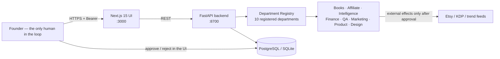
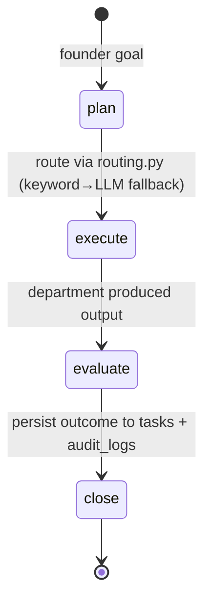

# ARCH — AI Business HQ · Architecture

> The one-page mental model every engineer and operator needs before touching this codebase.
> Audience: founders, engineers, ops — no prior context required.

---

## 1. Sixty-second summary

**AI Business HQ is an autonomous business operating system, not another chatbot.**
A founder types a goal ("write a children's book about a turtle who loves to draw") and a LangGraph
"CEO" decomposes it into a routed task executed by registered departments (books.content, books.market,
affiliate, intelligence, finance, qa …). Every external effect (publishing, spending, sending) is blocked
until a human approval exists — or fails hard and honestly, never silently.



---

## 2. Layer map

| Layer | Tech | Responsibility |
|---|---|---|
| **Presentation** | Next.js 15 (App Router, TypeScript, Tailwind v4) | Authenticated UI behind a Founder-Token gate |
| **API gateway** | FastAPI (Pydantic v2, UVicorn) | Auth, rate/row limits, orchestration entrypoints |
| **Intelligence** | LangGraph StateGraphs + LangChain | The CEO graph, department supervisors + agents |
| **Source of truth** | `agents/registry.py` (Python dataclass registry) | Which departments exist, what they may do, their budgets |
| **Transactional store** | PostgreSQL (auto-pool via `psycopg_pool`) with SQLite thread-safe fallback | tasks, executions, opportunities, products, approvals |
| **Knowledge plane** | `agents/fees/`, `agents/localization/`, `agents/profiles.py` | Verified fee models + per-language prompts/fonts/rules |
| **Demo reliability** | `AIHQ_FAKE_LLM=1` | Deterministic answers with zero API spend — offline everywhere |

---

## 3. The three departments of the codebase

```
hq/
├── frontend/       ← Next.js 15 UI (Dashboard, CEO Chat, Departments, …)
├── backend/        ← FastAPI routers, services, DB layer (backend/app/)
├── agents/         ← LangGraph graphs + capabilities + departments (the brains)
├── tests/          ← 115 pytest tests — offline-first, no network required
├── database/       ← schema.sql (reference; real migrations run at boot)
├── fonts/          ← Amiri-Regular.ttf (Latin coverage used for book PDFs)
├── CHANGES.md      ← versioned changelog + verification table
└── README.md       ← product overview & quickstart
```

---

## 4. Frontend — `frontend/`

**Why one SPA:** every page is client-side; there are no server components doing data fetching.
Every page calls the same typed API client (`frontend/lib/api.ts`) with a Bearer token read
from `localStorage["founder_token"]`.

**Pages (13):** `/dashboard · /ceo · /departments · /agents · /capabilities · /books · /products · /opportunities · /profiles · /approvals · /reports · /observability · /settings`

- **Shell** (`components/Shell.tsx`) — sidebar grouped **Company / Output / System**, top bar with
  Operational status + FOUNDER badge, page title bar. Founder Token gate is embedded app-wide.
- **i18n** (`lib/lang.tsx`) — English-only (by founder request); all UI strings live here.
- **Routing** — one `useLang()` hook, `t("key")` covers every string; no hardcoded prose in pages.
- **Transport** — `api.ts` throws `ApiError(401, ...)` on auth failures; `Shell` listens for the
  `hq:unauthorized` event and re-opens the Founder Token gate exactly once.

---

## 5. Backend — `backend/app/`

**App factory** — `main.py` builds the FastAPI app, registers **13 routers** under `/api`, applies CORS
(explicit origin list, HTTP methods allow-list), wires a boot-time `lifespan`: deps imported →
schema auto-migrated → market profiles seeded → optional APScheduler (08:00 daily `daily_research.run`).

| Router | Endpoints (prefix `/api`) | What it does |
|---|---|---|
| `health.py` | `/health` (public, `{status:"ok"}`), `/admin/health` (founder token) | Liveness + truthful admin view (ETSY configured? LLM mode? counts?) |
| `ceo.py` | `/ceo/run` `POST`, `/audit` | Submit a goal to the CEO graph |
| `departments.py` | `/departments` list + `/{key}/run` | List/run any registered department |
| `books.py` | `/books` … book lifecycle + PDF streaming | Story → images → PDF → QA → publish request |
| `opportunities.py` | `/opportunities` + `PATCH {id}/status` | Opportunity pipeline with source badge |
| `approvals.py` | `/approvals` list + `/{id}/decide` | Human gate — approve/reject with audit row |
| `reports.py` | `/reports` list + download | Report artifacts |
| `settings.py` | `/settings`, `/settings/autonomy` | Founder-facing config (no secrets over the wire) |
| `agents.py` | `/agents` list | Agent cards from the registry |
| `capabilities.py` | `/capabilities` | Registered capabilities (id, steer, used_by) |
| `observability.py` | `/observability` | Live counts, task graph, measured vs unmeasured tokens |
| `tests.py` | `/tests` | Post-publish capture (views/favorites/sales) |
| `profiles.py` | `/profiles` CRUD + toggle | Market profiles (enable/disable, refs, seasonal calendar) |

**Services layer** — `services/store.py` (all DB helpers, enforced budget cap, `hmac.compare_digest`
on the founder token), `services/autonomy.py` (autonomy_level 0–3 policy enforcement),
`auth.py` (bearer dependency).

**DB layer** — `db.py` picks Postgres via `psycopg_pool.ConnectionPool` (min 1, max 5,
`check_connection` on checkout; `max_idle=60`, `max_lifetime=300`) and falls back to a fresh,
thread-safe SQLite connection per call when `DB_BACKEND=auto` and PG is unreachable.
Every exception is sanitized (`_sanitize()` → `[redacted]`) before it ever reaches a log or API response.

---

## 6. Agents — `agents/` (the brain)

### 6.1 The CEO graph (`agents/ceo/graph.py`)

Four nodes — deliberately dumb, deterministic orchestration:



`agency guards` inside `_execute`:

1. **Autonomy gate** — level 0: nothing runs; 1 = research departments only; 2 = all; 3 = reserved.
2. **Approval gate** — departments with `approval_policy="human_required"` never run without an
   `approvals` row. The body flag `human_confirmed` is ignored.
3. **Budget gate** — `budgets` table: flat $0.15 per finished task, capped at $50/month.
4. **Credential gate** — Etsy/KDP secrets required for publish (502, `draft_failed`, never a fake id).

`routing.py` — single source of truth for routing. Latin word-boundary matching, specificity tie-breaker
(`affiliate > qa > finance > …`), phrase matching for multi-word (`marché du livre`), keyword→LLM fallback.

### 6.2 Departments — the registry pattern

Every department registers itself with a `DepartmentSpec` at import time. To add a new department:
write a module in `agents/departments/<sector>/<file>.py`, call `register(DepartmentSpec(…))` at the bottom —
no CEO, API, or UI changes needed.

Registered today (10):

| key | sector | what it does | approval policy |
|---|---|---|---|
| `books.market` | books | Trends + Etsy scan → children's-book opportunities report | none |
| `books.content` | books | Story idea → images → print PDF | story_review |
| `books.publishing` | books | Etsy draft after **founder sign-off** | human_required |
| `intelligence` | intelligence | Niche scan + scored opportunities (0–10) | none |
| `affiliate` | affiliate | Public affiliate products + Python economics | before publish |
| `marketing` | marketing | SEO / listing copy / Pinterest / calendar | before publish |
| `finance` | finance | Etsy/KDP fees + unit economics (deterministic) | none |
| `qa` | qa | Deterministic preflight gate (structure, images, PDF, Etsy limits, font) | gate |
| `product` | product | Opportunity → candidate product | none |
| `design` | design | Image-provider hook (stub) | before publish |

Each department has one or more **supervisors** (LangGraph `StateGraph`) that route to workers:
`researcher → scorer → reporter`, `story_writer → illustrator → pdf_builder`, etc.
Supervisors are either `ScriptedChatModel` (deterministic, offline, free) in `AIHQ_FAKE_LLM=1` mode or the
configured live model wrapped in `ResilientChatModel` (live model → deterministic fallback).

### 6.3 Capabilities vs departments — the division of labor

- **Department** = a *run*: given a goal, plan, agents, budget, approval policy.
- **Capability** = a *reusable skill*: one implementation (`agents/capabilities/*.py`) used by many
  departments, registered in `capabilities/__init__.py` (e.g. `content_generation` used by books.content,
  books.market, marketing, intelligence).

---

## 7. Data model

Single database (Postgres via pool or SQLite); tables all carry `workspace_id='default'`.

| Table | What lives there |
|---|---|
| `tasks` | one row per delegated goal (type, domain, status, detail) |
| `task_executions` | one row per agent run; `tokens_used` is **NULL when the provider returns nothing** |
| `approvals` | `pending → approved/rejected` — the *only* source of truth for human sign-off |
| `opportunities` | title, niche, score, `source live/partial/demo`, `evidence` JSON |
| `products` | slug, title, status (`story → images → pdf → qa → draft_failed/draft_created/published`) |
| `reports` | generated report artifacts with source badges |
| `settings` | single-writer key/value (`autonomy_level`, …) — all writes go through `set_setting()` |
| `budgets` | monthly USD cap (default $50); enforced at task creation |
| `market_profiles` | us-en · fr-fr · sa-en seasonal calendars, fee_model_ref, font, QA refs |
| `audit_logs` | every moral-significant action — CEO plan/execute, approvals, publishes |

---

## 8. Skeptic checklist (the truthfulness rules)

| Rule | Enforced where |
|---|---|
| **No fabricated Etsy listing id ever flips a product to published** | `marketplace.publish_after_approval()` raises `EtsyError` on any failure; tests in `test_phase1_etsy.py` |
| **No invented fees** — every rule carries `source_url` + `last_reviewed` | `agents/fees/etsy.py`, `agents/fees/kdp.py`, `agents/fees/registry.py`; `tests/test_phase3_fees.py`, `test_item7_profiles.py` |
| **No invented OI/commission/LLM token counts** — absent = NULL | `agents/llm.py` `last_usage_call()`; `finish_execution` writes NULL; `/api/observability` splits measured vs unmeasured |
| **No fake opportunities** when no live keys — explicit `demo` source or nothing | `intelligence` refuses unless `AIHQ_ALLOW_DEMO=1`; badges in UI; `test_phase2_gates.py` |
| **No inline human approval** — sign-off must exist as an approvals row | `approvals.py` ignores `human_confirmed` body; `test_approval_gate.py` |
| **Unknown fee models stay untrusted** — EU/Global/kdp.eu/kdp.global = `partial`, never guessed | `agents/fees/registry.py` |

---

## 9. Execution lifecycle — a worked example

Founder: **"Write a children's book about a turtle who loves to draw"**

1. `POST /api/ceo/run` → `runner.run_task()` (behind Bearer auth)
2. CEO `plan` → `route_task()` → `books.content`
3. `execute` → autonomy gate (level 1 = research only — books.content is level 2, so needs level 2 … or
   raises 403 here — see autonomy policy `_LEVEL_DEPS`) → approvals checked (none required yet)
4. `books.content` registers itself, runs `story_writer` (LLM) → `illustrator` (PIL or OpenAI images) →
   `pdf_builder` (Amiri) writing into `storage/books/<slug>/`
5. Task marked finished; ~$0.15 charged against `budgets`; `audit_logs` rows written
6. Founder reviews in `/books`, then requests publishing: `/api/books/<slug>/publish-request`
   → **approvals** row created (`pending`) — nothing external happens yet
7. Founder clicks Approve → `/api/approvals/{id}/decide` — runs the **real Etsy v3 flow**
   (OAuth refresh, listing upload, cover image, taxonomy) — success: `draft_created`; failure: `draft_failed`
   (never fake)

---

## 10. Configuration & operations

**Canonical env** (`.env.example` is the source of truth):

| Var | Meaning |
|---|---|
| `FOUNDER_TOKEN` | Bearer for every `/api/*` except `/api/health` |
| `DATABASE_URL` / `DB_BACKEND` | `auto` (PG→SQLite fallback), `supabase` (required), `sqlite` (offline) |
| `DB_POOL_MIN/MAX/MAX_IDLE/MAX_LIFETIME` | Pool sizing for PG (defaults 1/5/60/300) |
| `AIHQ_FAKE_LLM` | `1` = deterministic offline demo (zero API spend) |
| `AIHQ_ALLOW_DEMO` | `1` = allow clearly-labelled demo data into the pipeline |
| `ETSY_KEYSTRING` / `ETSY_SHARED_SECRET` / `ETSY_REFRESH_TOKEN` / `ETSY_SHOP_ID` | Etsy v3 credentials |
| `MISTRAL_API_KEY` / `LLM_PROVIDER` / `LLM_MODEL` | Live LLM selection |
| `ENABLE_SCHEDULER` + `TZ` | opt-in daily opportunity scan |
| `FOUNDER_TOKEN` | **CHANGE THIS** — the one secret every operator must regenerate |

**Docker** — `docker-compose up --build` (backend :8700, frontend :3000).
**Tests** — `AIHQ_FAKE_LLM=1 .\.venv\Scripts\python.exe -m pytest tests/ -q`
(**111 tests, offline by design — no network required except 1 Postgres-gated case**).

---

## 11. Adapting HQ to your business

**Publishing business pipeline (3.3.0):** founder request → `books.market` collects evidence
(market_research module, typed collectors) → opportunity_engine scores 0–10 → founder picks one
→ `books.content` stores a Product Brief and waits for approval → `design` generates illustrations
→ `books.content` builds the full book → `qa` runs preflight checks → API returns square PDF + KDP interior
→ founder reviews in `/products/[slug]` → approves → `books.publishing` submits to Etsy after sign-off.

**Never auto-publish.** Every step that touches an external platform has an `approval_policy` and records an approval row before running.

1. **New department?** Create `agents/departments/<sector>/<file>.py`, implement a LangGraph supervisor,
   `register(DepartmentSpec(...))`, import it from `agents/departments/__init__.py`. The API, UI,
   agents page and audit ledger pick it up automatically.
2. **New market?** Add a row to `market_profiles` (via UI or boot seed in `profiles.py`) with
   `fee_model_ref`, `story_prompt_ref`, `font_ref`, `text_direction`, `seasonal_calendar`, `qa_ruleset_ref`.
   Verified fee models live in `agents/fees/registry.py` — anything not listed is `partial` and untrusted by design.
3. **New capability?** Implement + `register_capability(CapabilitySpec(...))` in
   `agents/capabilities/<name>.py`; departments declare `allowed_tools`.
4. **New language/QA?** Extend `agents/localization/__init__.py` (en/fr supported; ar removed per founder request).

---

## 12. Known boundaries (honest)

- **Design** department is a stub — no real image-gen provider is wired by default
- **Publish path is never exercised against a live Etsy shop** in CI/tests (credentials required)
- **No real-time workers** — a 12-image book blocks the HTTP request; scale-out is per-request
- **Seasonal calendar seeds are month-range placeholders**, editable on /profiles
- **`sa-en` fee model is unverified** — total_fees/net_receipt return `null`, margin defaults to 5.0
- **Budget enforcement** is flat $0.15/task, not measured token cost

---

## 13. Further reading inside the repo

- `README.md` — product overview & quickstart
- `CHANGES.md` — every change with verification status (`live` / `partial` / `demo`)
- `tests/` — the feature-to-test map; start with `test_hq.py`
- `agents/registry.py` — the department registry (30 lines; start here)
